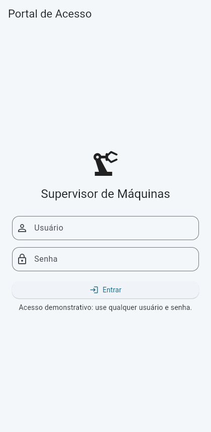
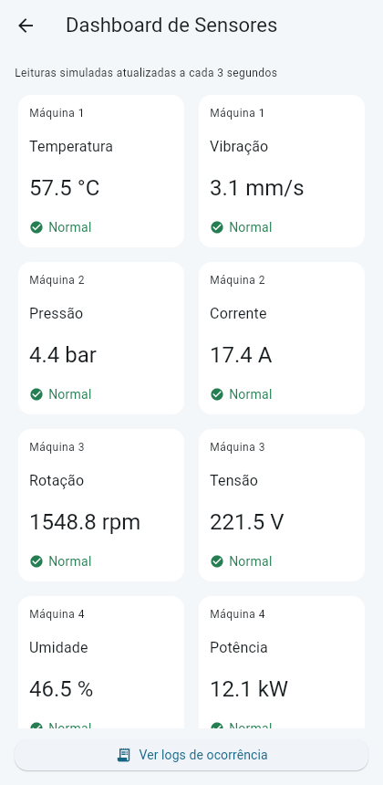
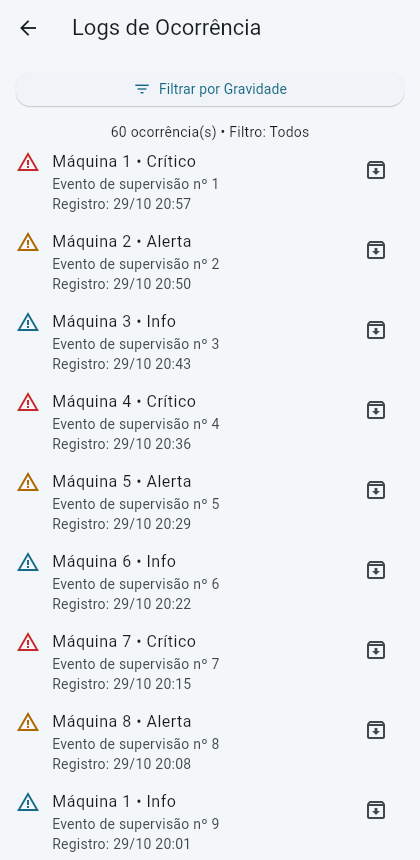
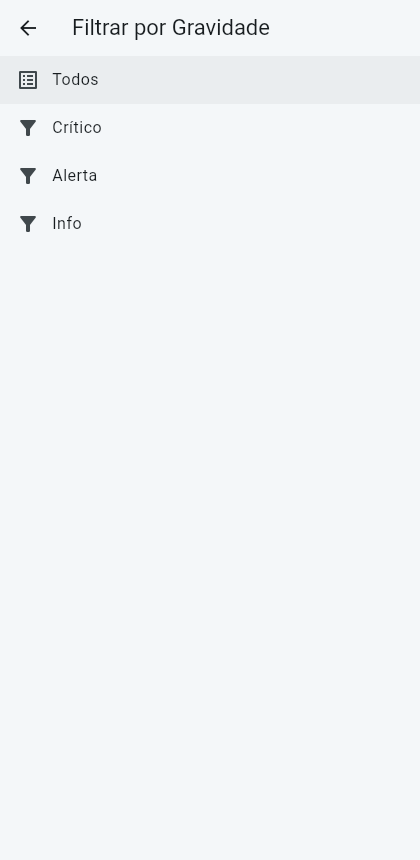

# Supervisor de Maquinas - Flutter

Protótipo acadêmico de supervisão industrial com 4 telas: Login, Dashboard, Logs e Filtro.

## Requisitos
- Estrutura `lib/models`, `lib/themes`, `lib/widgets`, `lib/screens`.
- `ThemeData` global definido em `app_theme.dart`.
- Widgets reutilizáveis `BotaoAcao` e `CardSensor`.
- Login demonstrativo (sem autenticação real) e `Navigator.push`.
- 8 sensores simulados atualizados a cada 3 segundos em `GridView.builder`.
- 60 ocorrências em `ListView.builder` com ListTile completo.
- Carregamento com `initState`, `Future.delayed` de 2 segundos, loading e proteção `mounted`.
- Filtro por gravidade retorna via `Navigator.pop`; resultado aplicado após `await` e informado em SnackBar.
- Reconhecimento de alarmes atualizado com `setState`.
- `dispose` de controladores de texto e timer.

## Executar
1. `flutter create supervisor_maquinas`
2. Copie a pasta `lib` e o `pubspec.yaml` deste pacote para o projeto criado.
3. `flutter pub get --offline` (ou `flutter pub get` em redes liberadas).
4. `flutter run -d chrome --no-pub`

Sem dependências de terceiros. Login aceita qualquer usuário e senha não vazios.

---

## 📸 Demonstração (app em execução)

As capturas abaixo foram obtidas com o projeto **rodando** via
`flutter run -d web-server`, confirmando que ele compila e funciona.

> Acesso demonstrativo: use qualquer usuário e senha na tela de login.

### 1. Portal de Acesso (Login)

### 2. Dashboard de Sensores
Leituras simuladas (temperatura, vibração, pressão, corrente, rotação, tensão,
umidade e potência), com status Normal/Atenção por card.

### 3. Logs de Ocorrência
Lista com 60 ocorrências classificadas por gravidade (Crítico, Alerta, Info).

### 4. Filtro por Gravidade
Filtragem das ocorrências por nível de severidade.

